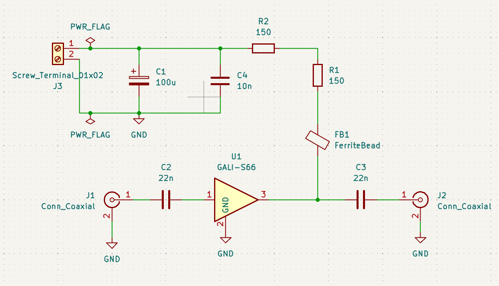
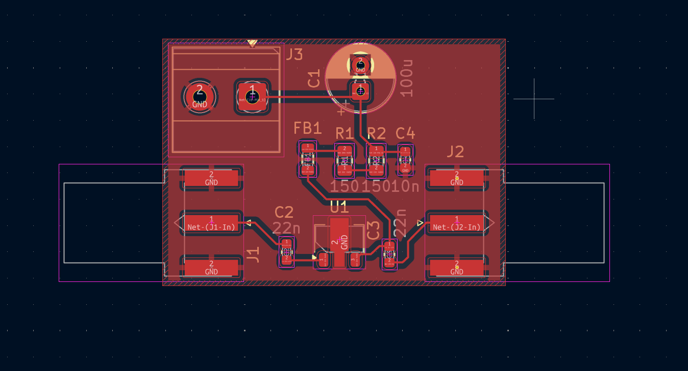
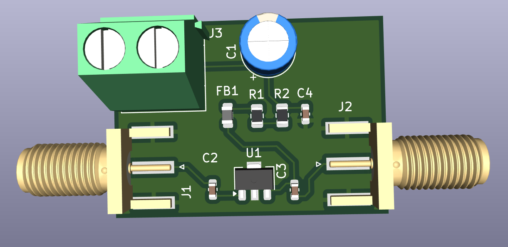

# 03 - RF Amplifier (Mini-Circuits GALI-S66+)

A custom 2-layer PCB implementation of a wideband, high-linearity RF amplifier built around the **Mini-Circuits GALI-S66+** monolithic microwave integrated circuit (MMIC). Designed in **KiCad**, this board features controlled-impedance $50\ \Omega$ microstrip routing, edge-launch SMA coaxial interfaces, dual-layer ground-plane shielding, and an integrated bias-tee power network.

---

## 📂 Repository Structure

```text
03 - RF Amplifier/
├── KiCad/          # KiCad project files (.kicad_pro, .kicad_sch, .kicad_pcb)
├── Images/         # Schematic and board visualizations
│   ├── schematic.png
│   ├── pcb_2d.png
│   └── pcb_3d.png
└── README.md       # Project documentation
```

---

## 📷 Project Visuals

### Schematic Design
The schematic captures the complete RF signal chain, DC-blocking capacitors, and the bias-tee network delivering DC power to the amplifier's output pin via an RF choke.



### 2D PCB Layout
The 2D layout highlights the straight, unobstructed $50\ \Omega$ RF path from input to output alongside the top-side DC power and bias filtering network.



### 3D PCB Render
A 3D view showing the edge-launch SMA connectors sitting flush against the $1.6\text{ mm}$ board edge and the compact `SOT-89-3` placement for `U1`.



---

## 1. Circuit Overview

The GALI-S66+ is a high-dynamic-range, wideband RF gain block covering DC to $3\text{ GHz}$. Because MMIC amplifiers receive their DC bias current directly through their RF output pin, the circuit is divided into two functional stages:

1. **$50\ \Omega$ RF Signal Path (`J1` $\rightarrow$ `C2` $\rightarrow$ `U1` $\rightarrow$ `C3` $\rightarrow$ `J2`):** Amplifies incoming RF signals while isolating DC bias voltages from external test equipment or antennas.
2. **DC Bias-Tee & Power Filtering Network (`J3` $\rightarrow$ `C1` / `C4` $\rightarrow$ `R2` + `R1` $\rightarrow$ `FB1`):** Supplies regulated DC operating current to `U1` (Pin 3) while preventing high-frequency RF energy from leaking back into the power supply.

---

## 2. Bill of Materials (BOM) & Component Rationale

Every component, symbol, and KiCad footprint was selected to balance high-frequency RF signal integrity, thermal power handling, and ease of hand assembly.

| Reference | Component & Value | KiCad Symbol | KiCad Footprint | Engineering Rationale |
| :--- | :--- | :--- | :--- | :--- |
| **U1** | Mini-Circuits GALI-S66+ | `RF_Amplifier:GALI-S66` | `Package_TO_SOT_SMD:SOT-89-3` | Provides flat wideband gain across RF frequencies. The `SOT-89-3` package includes a large exposed ground/thermal tab on Pin 2 for low-inductance grounding and heat dissipation. |
| **J1, J2** | Edge-Launch SMA Connectors ($50\ \Omega$) | `Connector:Conn_Coaxial` | `Connector_Coaxial:SMA_Amphenol_132289_EdgeMount` | Upgraded from SMB to standard SMA for superior mechanical durability and broader test-equipment compatibility. Designed to straddle a standard $1.6\text{ mm}$ PCB edge so coaxial cables mate parallel to the board plane. |
| **J3** | 2-Pin DC Power Terminal | `Connector:Screw_Terminal_01x02` | `TerminalBlock_Phoenix:TerminalBlock_Phoenix_MKDS-1,5-2_1x02_P5.00mm_Horizontal` | Standard $5.00\text{ mm}$ pitch screw terminal allows secure, tool-assisted connection of bench power supply leads without accidental pull-outs. |
| **C2, C3** | $22\text{ nF}$ DC-Blocking Capacitors | `Device:C` | `Capacitor_SMD:C_0603_1608Metric` | Blocks DC bias voltage from reaching `J1` and `J2`. The compact imperial `0603` (`1608Metric`) package minimizes parasitic series inductance and physical width discontinuities along the $50\ \Omega$ RF transmission line. |
| **C4** | $10\text{ nF}$ High-Frequency Bypass Cap | `Device:C` | `Capacitor_SMD:C_0603_1608Metric` | Shunts residual high-frequency RF noise on the DC bias rail directly to ground. Sized at `0603` (`1608Metric`) for low self-inductance and reliable DRC pad clearance. |
| **C1** | $100\ \mu\text{F}$ Bulk Decoupling Cap | `Device:C_Polarized` | `Capacitor_SMD:CP_Elec_6.3x5.4` | Bulk electrolytic capacitor that smooths low-frequency power supply ripple and transient current demands at the DC input connector. |
| **R1, R2** | $150\ \Omega$ Bias Resistors ($\times 2$) | `Device:R` | `Resistor_SMD:R_0805_2012Metric` | Placed in series to provide $300\ \Omega$ total bias resistance (ideal for $\sim 9\text{ V}$–$12\text{ V}$ supply operation at $\sim 50$–$65\text{ mA}$). Splitting the resistance across two `0805` packages safely distributes $\sim 0.2$–$0.3\text{ W}$ of heat dissipation across both resistors. |
| **FB1** | Ferrite Bead / RF Choke | `Device:FerriteBead` | `Inductor_SMD:L_0805_2012Metric` | Acts as a high-impedance RF choke at operating frequencies while passing DC bias current into Pin 3 (`OUT`) with minimal voltage drop. The `0805` package comfortably handles the DC bias current without saturating. |

---

## 3. PCB Layout & RF Design Decisions

* **Board Stackup & Controlled Impedance:** Designed for a standard 2-layer **$1.6\text{ mm}$ FR4** substrate with `F.Cu` carrying signal traces and `B.Cu` acting as a continuous ground reference plane. RF traces between `J1`, `C2`, `U1`, `C3`, and `J2` are routed as straight, direct $50\ \Omega$ microstrip lines ($\sim 3.0\text{ mm}$ width) with no $90^\circ$ bends or via transitions to prevent impedance reflections.
* **Dual-Layer Ground Pour & Via Stitching:** Both top (`F.Cu`) and bottom (`B.Cu`) layers are flooded with solid `GND` copper pours. Ground vias are offset slightly from component pads (avoiding co-located via-in-pad drill conflicts) to stitch the top and bottom reference planes together and provide a low-inductance return path for `U1`.
* **Edge-Launch Alignment:** The `Edge.Cuts` board boundary bisects the mounting tabs of `J1` and `J2` so the SMA center pins and ground legs sit flush against the top and bottom copper surfaces.
* **Silkscreen Hygiene:** Overlapping footprint value strings and redundant library labels were hidden on `F.SilkS`, leaving clean, legible reference designators (`U1`, `C1`–`C4`, `R1`–`R2`, `FB1`, `J1`–`J3`) for assembly.

---

## 4. Fabrication & Assembly Notes

1. **Gerber Generation:** Exported standard RS-274X Gerber layers (`F.Cu`, `B.Cu`, `F.Mask`, `B.Mask`, `F.SilkS`, `B.SilkS`, `Edge.Cuts`) alongside Excellon drill files (`.drl`), verified with zero Design Rules Checker (DRC) violations.
2. **Board Specs for Ordering:**
   * **Layers:** 2
   * **Thickness:** $1.6\text{ mm}$
   * **Material:** FR-4 ($\varepsilon_r \approx 4.4 - 4.6$)
   * **Copper Weight:** $1\text{ oz}$ ($35\ \mu\text{m}$)
3. **Power Supply Polarity:** Double-check polarity at screw terminal `J3` (Pin 1 = `+VCC`, Pin 2 = `GND`) before applying power, as `C1` and `U1` are polarity-sensitive.